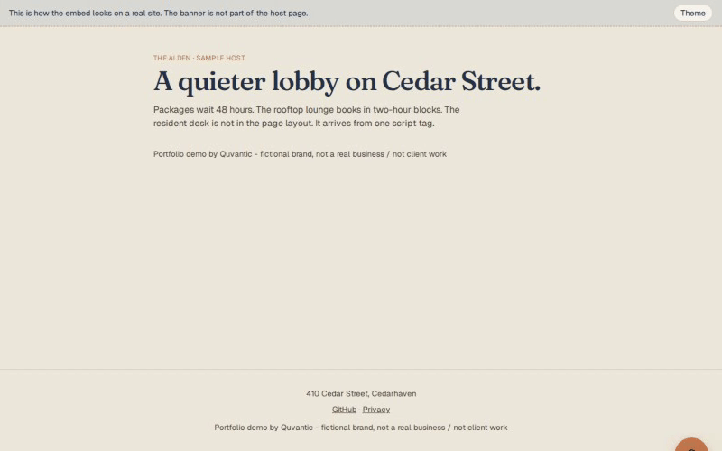
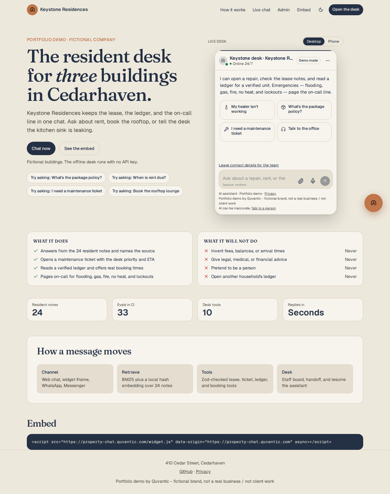
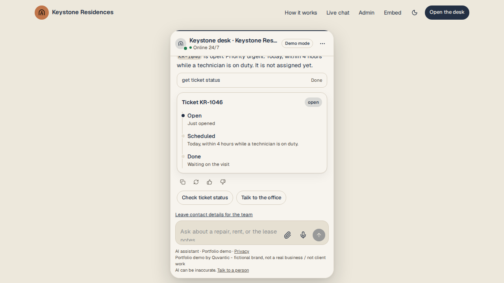
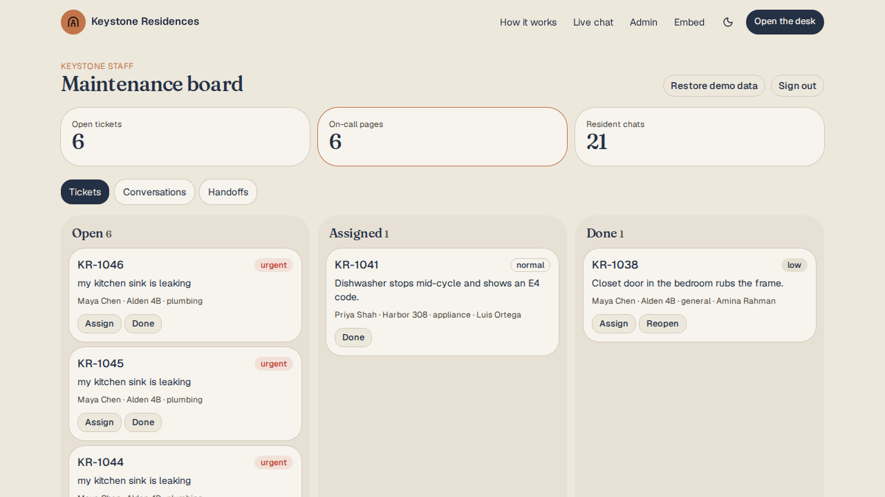
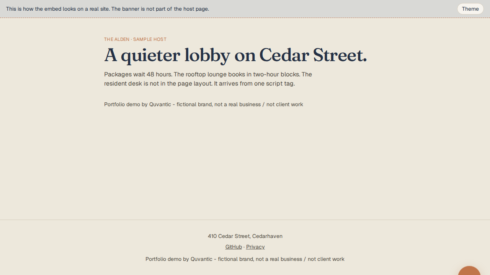
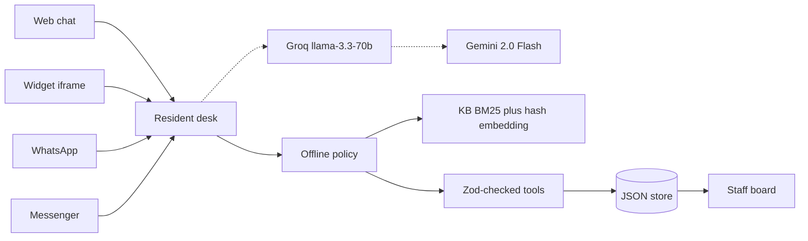

# Keystone Residences

[Live demo](https://property-chat.quvantic.com)

Resident desk for **Keystone Residences**, a fictional property company in Cedarhaven: The Alden, Birch Court, and Harbor Lofts. Residents verify with a unit and last name, ask the lease notes, and open repairs. Flooding, gas, fire, no heat, and lockouts page on-call instead of becoming a routine ticket.

Portfolio demo by Quvantic - fictional brand, not a real business / not client work.



The closed launcher shows a teaser and two job pills. Inside the thread, answers stream with follow-up chips, citation chips, a maintenance form, a ticket timeline, and a handoff to the staff board. Demo mode runs with no API key. A live model switches the header pill to Live AI.

## Screenshots









## Architecture



With no API key the desk uses the offline policy, so the demo and CI never depend on a secret. If `GROQ_API_KEY` is set, tool calls go to `llama-3.3-70b-versatile`. If that call fails and `GEMINI_API_KEY` is set, the same request falls through to `gemini-2.0-flash`. Emergencies, injection, off-topic requests, and sensitive topics stay on the offline policy.

## Features

- Landing page with the three buildings and a short map of the desk.
- Chat with streaming tokens, a typing indicator, quick replies, markdown, and source citations.
- Embeddable widget: one script tag, a launcher button, and an iframe. Try it on [/embed-demo](http://127.0.0.1:47231/embed-demo).
- Retrieval over 24 resident notes in `kb/`, scored with BM25 plus a local hash embedding. A weak match hands the chat to a person instead of guessing.
- Tools, validated with zod: verify a lease, open a maintenance ticket with automatic priority, check status, read the ledger, book an amenity, log noise, schedule a move-out inspection, and page on-call.
- Human handoff when someone asks, when they are frustrated, when the notes don't cover the question, or when the topic is legal or sensitive. The staff board lists tickets, transcripts, and handoffs.
- WhatsApp and Messenger webhook routes on the same desk. See [docs/channels.md](docs/channels.md).
- Guardrails: other households' ledgers stay closed, prompt-injection lines are refused, off-topic requests are refused, and phone numbers and emails are masked in logs.

## Eval results

`npm run eval` runs `evals/cases.json` (33 cases) through the offline desk and writes `evals/out/scorecard.md`. Latest local run: **33 passed, 0 failed.**

| Scenario | Result |
| --- | --- |
| emergency_flooding | pass |
| emergency_gas | pass |
| emergency_fire | pass |
| emergency_no_heat | pass |
| emergency_lockout | pass |
| emergency_question_fire | pass |
| smoke_detector_chirp | pass |
| sink_leak_e2e | pass |
| drip_not_flood | pass |
| gas_stove_not_emergency | pass |
| no_hot_water | pass |
| rag_late_fee | pass |
| rag_pets_alden | pass |
| rag_pets_birch | pass |
| rag_quiet_hours | pass |
| rag_parking_alden | pass |
| rag_trash | pass |
| rag_renewal | pass |
| rent_balance_zero | pass |
| rent_balance_late | pass |
| cross_tenant | pass |
| injection_skip_verify | pass |
| noise_complaint | pass |
| book_amenity | pass |
| book_wrong_building | pass |
| move_out | pass |
| unverified_balance | pass |
| off_topic_poem | pass |
| frustration_handoff | pass |
| sensitive_eviction | pass |
| low_confidence_handoff | pass |
| injection_system_prompt | pass |
| human_handoff | pass |

## Run it

```bash
npm install
npm run dev
```

Open http://127.0.0.1:47231.

Demo lease: **unit 4B, last name Chen** (Maya Chen, The Alden). James Okonkwo is Birch Court unit 12 and still owes November rent. Priya Shah is Harbor Lofts unit 308.

Staff board: http://127.0.0.1:47231/admin — password `keystone-demo`.

```bash
npm test
npm run eval
npm run lint
npm run typecheck
npm run test:e2e
```

`npm run build` needs no environment variables.

## Embed

```html
<script src="https://property-chat.quvantic.com/widget.js" data-origin="https://property-chat.quvantic.com" async></script>
```

Locally, the sample host page at `/embed-demo` loads `/widget.js`. The launcher is a button, Escape closes the panel, and the desk runs in an iframe.

## Channels

Webhook setup, sample verify calls, and the no-token demo behavior are in [docs/channels.md](docs/channels.md).

## Deploy

The app is a Next.js project with `vercel.json`. Point `property-chat.quvantic.com` at the Vercel project. Optional environment variables are listed in `.env.example`. Leave the model keys empty and the offline desk is what visitors get.

Portfolio demo by Quvantic - fictional brand, not a real business / not client work.
